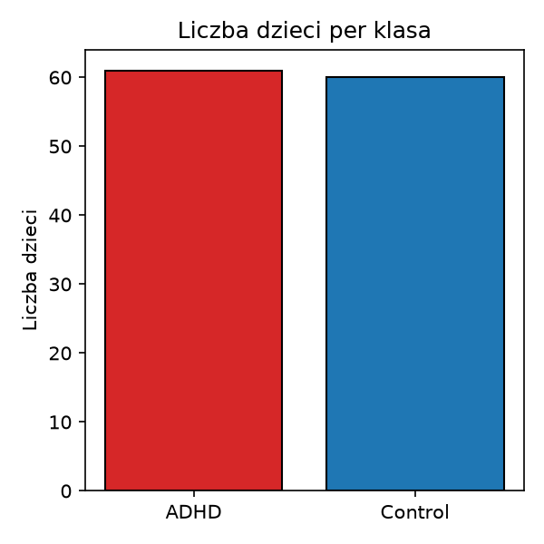
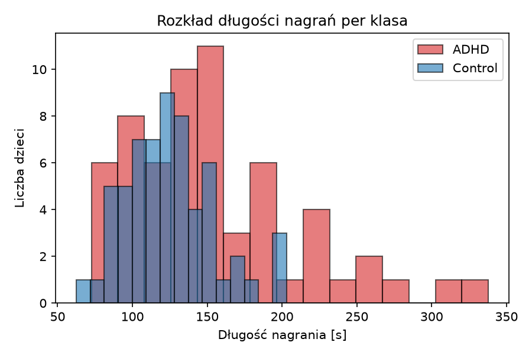
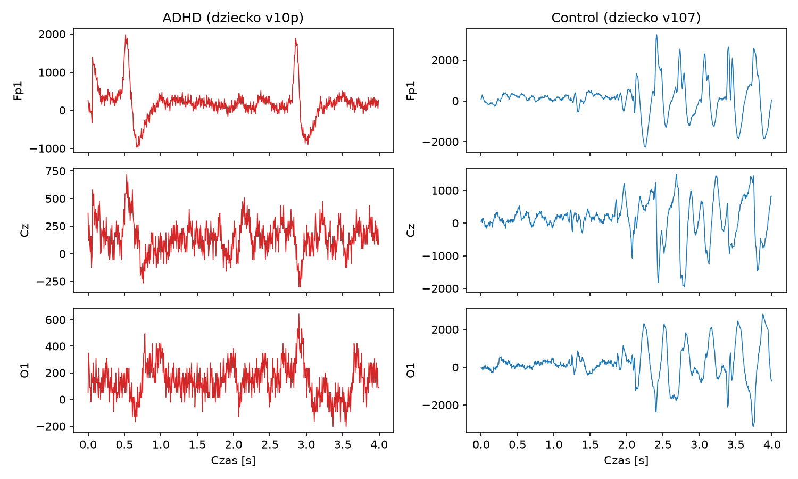
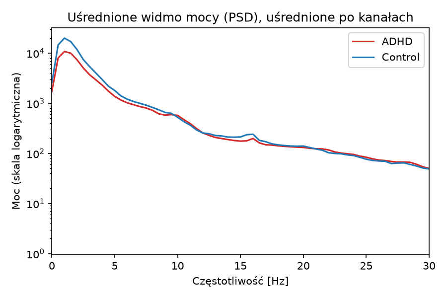
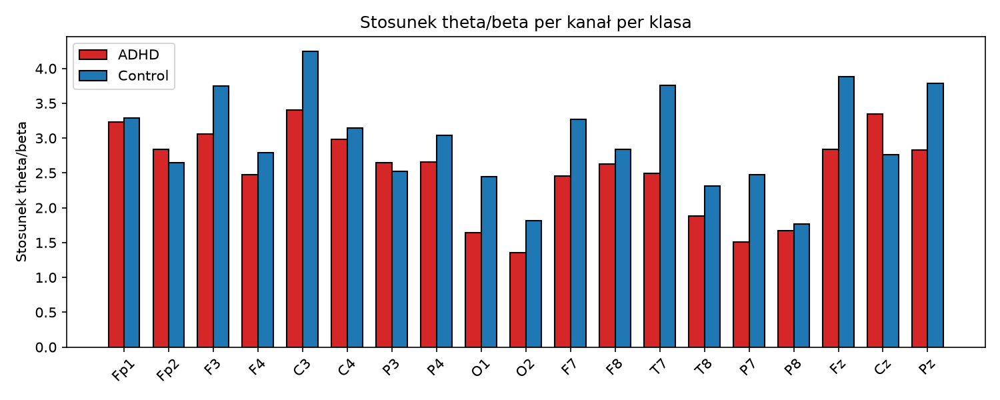
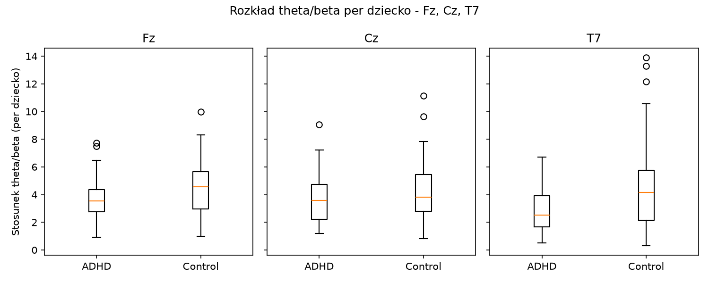
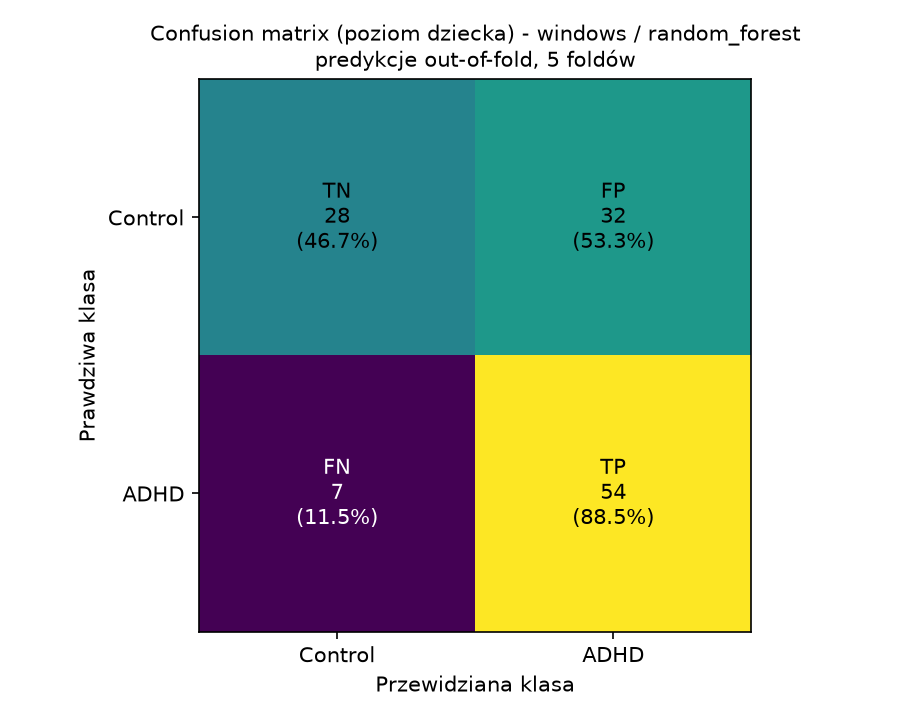
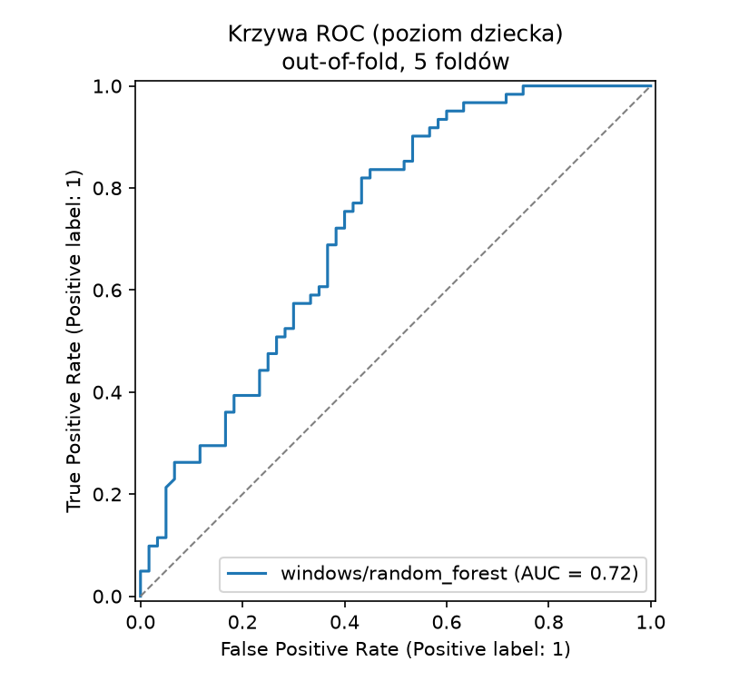
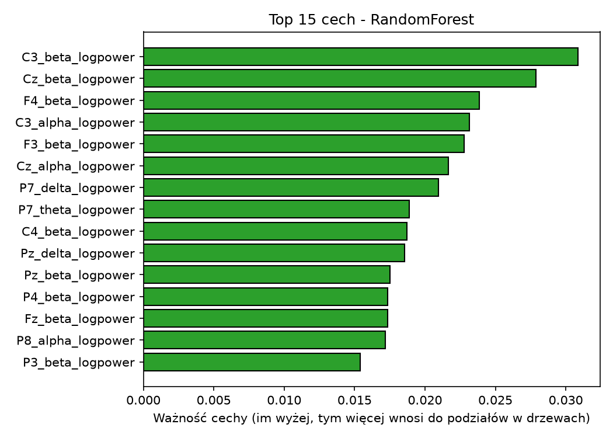

# Klasyfikacja ADHD na podstawie EEG

To zadanie rekrutacyjne do sekcji AI KN Neuron: binarna klasyfikacja ADHD vs Control
na podstawie sygnału EEG.

Nie jestem specjalistą od EEG. Wiedzę o pasmach częstotliwości i stosunku theta/beta doczytałem przy okazji tego zadania.

## Dane

Korzystam ze zbioru [EEG Dataset for ADHD](https://www.kaggle.com/datasets/danizo/eeg-dataset-for-adhd/data)
z Kaggle. Plik CSV wygląda na tabelaryczny, ale w środku jest to surowy, ciągły sygnał
czasowy: 121 dzieci (61 ADHD, 60 Control), 19 kanałów EEG, każdy wiersz to jedna próbka
czasowa, ponad 2 mln wierszy łącznie. Częstotliwości próbkowania 128 Hz nie ma w pliku,
wzięta jest z dokumentacji zbioru.

Wiersz nie jest tu niezależną obserwacją. Wiersze tego samego dziecka są mocno
skorelowane w czasie, więc zwykły losowy podział train/test prowadziłby do wycieku
danych - model uczyłby się rozpoznawać dziecko, nie ADHD. Dlatego cały pipeline dzieli
dane na poziomie dziecka, nie wiersza.

## Jak uruchomić

### 1. Pobranie danych

Plik jest za duży, żeby trzymać go w repozytorium (ok. 255 MB), więc nie jest w nim
commitowany (patrz `.gitignore`):

1. Pobierz dane z [Kaggle](https://www.kaggle.com/datasets/danizo/eeg-dataset-for-adhd/data).
2. Zapisz plik jako `adhdata.csv` w katalogu głównym repozytorium.

### 2. Instalacja i uruchomienie

**Opcja A - `uv` (zalecane):**

```bash
uv sync
uv run python main.py
```

**Opcja B - `pip`:**

```bash
python -m venv .venv
source .venv/bin/activate      # Windows: .venv\Scripts\activate
pip install -r requirements.txt
python main.py
```

`main.py` uruchamia po kolei EDA, trening i ewaluację. Całość trwa ok. 1 minuty,
większość czasu to liczenie cech z surowego sygnału.

### 3. Uruchomienie pojedynczych etapów

```bash
uv run python -m src.eda         # eksploracyjna analiza danych -> results/figures/
uv run python -m src.train       # trening + CV -> results/predictions.csv, results/feature_importance.csv
uv run python -m src.evaluate    # metryki + wykresy -> results/summary.csv, results/figures/
```

(bez `uv` analogicznie: `python -m src.eda` itd., po aktywowaniu `.venv`)

### 4. Notebook

```bash
uv run jupyter lab notebooks/analysis.ipynb
```

Notebook niczego nie trenuje. Wczytuje wyniki z `results/` (więc `train.py`
i `evaluate.py` muszą być uruchomione wcześniej) i pokazuje je przez te same funkcje,
których używają skrypty w `src/`.

## Struktura projektu

| Plik | Co robi |
|---|---|
| `main.py` | Uruchamia cały pipeline: EDA → trening → ewaluacja. |
| `src/config.py` | Wspólne stałe: kanały EEG, pasma częstotliwości, częstotliwość próbkowania, `random_state`, ścieżki do `results/`. |
| `src/data.py` | Wczytanie CSV, cięcie sygnału na okna 4-sekundowe i na całe nagrania. |
| `src/features.py` | Ekstrakcja cech: log mocy w pasmach (metoda Welcha) + stosunek theta/beta, per kanał. |
| `src/eda.py` | Eksploracyjna analiza danych: rozkład klas, długości nagrań, surowy sygnał, widmo mocy, theta/beta. |
| `src/train.py` | Trening: walidacja krzyżowa (5-fold, podział po dziecku), dwa modele, dwa warianty danych, zapis predykcji i ważności cech do CSV. |
| `src/evaluate.py` | Wczytuje wyniki `train.py`, liczy metryki, rysuje wykresy. Nic nie trenuje. |
| `notebooks/analysis.ipynb` | Notebook pokazujący EDA i wyniki bez ponownego treningu. |
| `results/` | Wygenerowane dane (CSV) i wykresy (PNG) - commitowane do repo. |
| `requirements.txt`, `pyproject.toml`, `uv.lock` | Zależności. |

## Metodyka (krótko)

- **Subject split:** każde dziecko trafia w całości albo do treningu, albo do testu,
  nigdy do obu. Walidacja krzyżowa (`StratifiedKFold`, 5 foldów) działa na poziomie
  dziecka, nie wiersza czy okna.
- **Dwa warianty danych:** okna 4-sekundowe (512 próbek, bez nakładania, niepełne
  okno na końcu odrzucone) oraz całe nagranie jako jeden segment.
- **Cechy (95 na segment):** log mocy w 4 pasmach (delta, theta, alpha, beta - metoda
  Welcha) dla każdego z 19 kanałów. Stosunek theta/beta dodałem jako dodatkową cechę,
  bo często pojawia się w kontekście EEG i ADHD.
- **Modele:** `LogisticRegression` (ze skalowaniem) i `RandomForest`, domyślne
  hiperparametry, bez strojenia.
- **Wagi próbek:** w wariancie okien każde okno dostaje wagę `1 / liczba okien jego
  dziecka`. Dzieci z ADHD mają średnio dłuższe nagrania, więc bez wag miałyby
  większy wpływ na uczenie modelu.

## Wyniki

Metryki na poziomie dziecka, średnia ± odchylenie standardowe po 5 foldach
(`results/summary.csv`):

| Wariant | Model | Balanced accuracy | Recall | Precision | F1 | ROC AUC |
|---|---|---|---|---|---|---|
| whole_recording | LogReg | 0.571 ± 0.051 | 0.608 ± 0.082 | 0.577 ± 0.061 | 0.587 ± 0.037 | 0.645 ± 0.082 |
| whole_recording | RandomForest | 0.660 ± 0.095 | 0.737 ± 0.110 | 0.650 ± 0.086 | 0.686 ± 0.081 | 0.737 ± 0.056 |
| windows | LogReg | 0.653 ± 0.049 | 0.722 ± 0.040 | 0.645 ± 0.067 | 0.678 ± 0.023 | 0.681 ± 0.067 |
| windows | RandomForest | 0.677 ± 0.058 | 0.887 ± 0.088 | 0.631 ± 0.049 | 0.735 ± 0.043 | 0.712 ± 0.028 |

### Wykresy

**EDA:**








**Model (windows / RandomForest - najlepszy wg balanced accuracy):**





## Ograniczenia

- Mały zbiór (121 dzieci). Odchylenia standardowe między foldami są spore (0.05-0.10
  na balanced accuracy), więc pojedyncze liczby trzeba czytać ostrożnie.
- Nie stroiłem hiperparametrów, żeby nie dopasować się do małego zbioru testowego.
- Próg decyzyjny zostawiłem na domyślnym 0.5, bez kalibracji.

## Wnioski

- Wszystkie 4 sprawdzone kombinacje (2 warianty danych × 2 modele) biją poziom
  losowy: balanced accuracy i ROC AUC wyraźnie powyżej 0.5.
- Różnice między kombinacjami mieszczą się w rozrzucie wyników między foldami
  (std rzędu 0.05-0.10). Nie wskazuję żadnej kombinacji jako wyraźnie najlepszej.
- Balanced accuracy wskazuje jako najlepszą kombinację windows/RandomForest
  (0.677), a ROC AUC - whole_recording/RandomForest (0.737). Różne metryki
  wskazują różnych "zwycięzców" - to kolejny sygnał, że żadna kombinacja nie ma
  wyraźnej przewagi.
- Najlepszy wg balanced accuracy model (windows/RandomForest) jest przechylony
  w stronę przewidywania ADHD: recall (0.887) jest dużo wyższy niż precision (0.631).
  Zostawiłem próg na domyślnym 0.5. Dobór progu wymagałby osobnego zbioru
  walidacyjnego, a ustawienie go na podstawie tych wyników byłoby dopasowaniem
  do danych testowych.
- Stosunek theta/beta wyszedł w moich danych odwrotnie niż kierunek najczęściej
  opisywany w literaturze dla EEG spoczynkowego: niższy u ADHD niż u Control,
  w większości kanałów. Nie próbuję tego tłumaczyć, zostawiam to jako obserwację.
- Najważniejsze cechy dla RandomForest to głównie moc w paśmie beta z różnych
  kanałów. 
